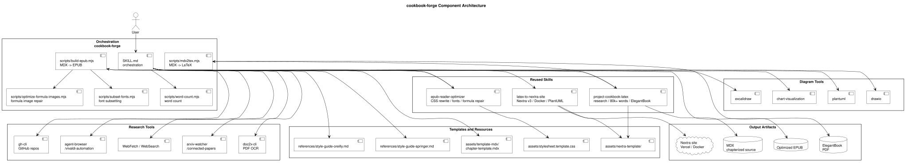
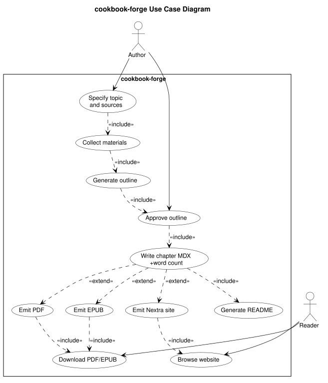
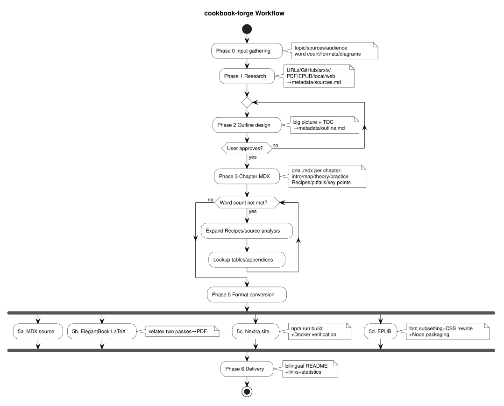

<p align="center">
  
</p>

<h1 align="center">Cookbook Forge</h1>

<p align="center">
  <strong>cookbook-forge</strong> — Domain CookBook / Handbook / Survey generator
</p>

<p align="center">
  From multi-source materials to chapterized MDX, then ElegantBook PDF,<br>
  Nextra website, optimized EPUB, and Typst PDF - all in O'Reilly CookBook and Springer Handbook style.
</p>

<p align="center">
  <a href="https://www.skills.sh/samonysh/cookbook-forge"></a>
  <a href="https://github.com/samonysh/cookbook-forge/releases/tag/v1.11.0"></a>
  <a href="https://github.com/samonysh/cookbook-forge/blob/main/LICENSE"></a>
</p>

<p align="center">
  <code>npx skills add samonysh/cookbook-forge</code>
</p>

---

## What It Is

`cookbook-forge` is an orchestrating Skill that produces a complete, in-depth technical book from a user's natural-language request and assorted source materials (web pages, PDFs, EPUBs, GitHub repos, arxiv papers, project docs, etc.).

It consolidates the core capabilities of three pre-existing Skills:

- **project-cookbook-latex** — exhaustive research, source-level analysis, coverage-driven deep-book structure, ElegantBook typography, PDF quality gates
- **latex-to-nextra-site** — Nextra v3 site scaffolding, Docker deployment, chapter renumbering, PlantUML/Drawio rendering, MDX conversion
- **epub-reader-optimizer** — EPUB CSS rewriting, font subsetting & embedding, formula-as-image HTML repair, spec-compliant packaging

## What It Does

- 📚 Generates CookBooks / handbooks / surveys on any technical domain
- 🔍 Multi-source research: web scraping (including sitemaps), GitHub repos, arxiv papers, PDF OCR, EPUB unpacking, local source/docs, web search
- 🔍 **Paper search**: supports `paper-search` (MCP) to search 20+ sources (arXiv, PubMed, Semantic Scholar, etc.)
- 🏛️ Architecture-first: produces a full map and chapter outline, aligns with the user, then writes chapter-by-chapter
- 📝 MDX as the canonical intermediate format: one `.mdx` per chapter for easy conversion to any downstream format
- ⚙️ **Two conversion paths**: LLM chapter-by-chapter conversion (three prompts) and deterministic `mdx2book.mjs`; the latter parses block by block, keeps prose verbatim, and uses explicit figure numbering `fig-NN-M` for structurally simple chapters
- 🚀 **Unified build entry**: `build-book.mjs` produces the EPUB and both PDFs in one command and names them after the book title; title parsing and filename sanitization live in `lib/book-meta.mjs`, so scripts no longer hardcode `book.epub` / `main.pdf`
- 🧾 **Auditable writing process**: four kinds of HTML annotations (`track` / `verify` / `source` / `FIGURE`) stay in MDX and are stripped uniformly at conversion time; `chapter-lint.mjs` validates the N.0–N.10 skeleton, figure slots, verification levels, and per-block run records
- 📊 **Measured dual-track ratio**: `ratio-count.mjs` counts prose CJK per `track` (code blocks, HTML comments and meta excluded; tables counted at 1/2), writes back to frontmatter with `--write`, and emits a report; warns when prose <120 chars, or table share >60% with prose <300 chars; synthesis is checked against 10%–15%, raised to 18% for chapters with a closing recap section (floor stays 10%)
- 📐 **Length driven by coverage**: after A0/A1 the total is derived from module count × recursion depth × concept density; floor is 50k CJK (`body3`: code blocks, HTML comments and meta excluded; tables counted at 1/2), no fixed per-chapter budget, chapter length follows module weight
- 🖼 **Cover gate**: when no artwork exists, draw a whole-book architecture diagram (spine / module groups / dependency direction) with diagram-design; `latex-check.mjs` verifies presence, 1280×1024 size, and non-blank pixels
- 🎨 Rich figures: HTML sources (exported to SVG via `assets/diagram-style/`) / mermaid / plantuml / drawio / excalidraw / chart, chosen based on user preference
- 📖 **MDX + four final formats** (combinable):
  - **MDX** (default): chapterized Markdown + JSX, the source format
  - **ElegantBook LaTeX + PDF**: built on [ElegantLaTeX/ElegantBook](https://github.com/ElegantLaTeX/ElegantBook), compiled with xelatex
  - **Nextra v3 website**: built on [Nextra](https://nextra.site), with dark mode, full-text search, i18n, KaTeX, one-click Vercel/Docker deploy
  - **Optimized EPUB**: h1–h4 typographic hierarchy at 1.9/1.5/1.22/1.08em (relative units, `inherit`-based colors readable in light/dark and inverted themes), subset-embedded LXGW WenKai, booktabs tables, tcolorbox-style code blocks, titled output
  - **Typst PDF**: built on [ilm](https://typst.app/universe/package/ilm) template, LXGW WenKai CJK fonts, four-color callout boxes, booktabs tables, rounded code blocks
- 🌏 Bilingual (Chinese/English) README for the produced book project (written by the agent in stage 6 from the template, not by a script)

## When to Use

Invoke when the user asks to:

- "Write a CookBook / handbook / survey / technical book about X"
- Consolidate assorted materials (web pages, PDFs, GitHub repos) into a multi-chapter long-form document
- Output any combination of PDF, online website, or EPUB
- Explicitly wants O'Reilly CookBook or Springer Handbook style

## Directory Layout

```
cookbook-forge/
├── SKILL.md                              # Main skill file (orchestration instructions)
├── README.md                             # Chinese readme
├── README.en.md                          # English readme (this file)
├── scripts/
│   ├── lib/
│   │   ├── diagram-renderer.mjs          # Unified diagram rendering pipeline (mermaid/plantuml -> Kroki SVG)
│   │   ├── mdx-utils.mjs                 # MDX frontmatter parser + HTML comment stripping
│   │   ├── latex-lint.mjs                # LaTeX lint/fix rules
│   │   ├── epub-lint.mjs                 # EPUB XHTML lint/fix + XML well-formedness rules
│   │   ├── typst-lint.mjs                # Typst lint/fix rules
│   │   ├── typst-optimize.mjs            # Deterministic Typst optimization (label injection, ref rewriting)
│   │   ├── word-caliber.mjs              # Prose caliber (CJK / tables at 1/2 / meta excluded), shared by word-count and ratio-count
│   │   ├── book-meta.mjs                 # Title resolution + cross-platform filename sanitization (--title > outline.md > main.tex > fallback)
│   │   └── cli-args.mjs                  # CLI argument conventions (--root requires the equals form)
│   ├── lmdx2tex.mjs                      # LLM-driven MDX -> ElegantBook LaTeX converter
│   ├── latex-check.mjs                   # LaTeX lint + rule fixes + per-chapter parallel probe compiles
│   ├── lmdx2typst.mjs                    # LLM-driven MDX -> Typst (ilm template) converter
│   ├── typst-check.mjs                   # Typst lint + rule fixes + per-chapter parallel probe compiles
│   ├── typst-fonts-check.mjs             # Typst font availability precheck
│   ├── lbuild-epub.mjs                   # LLM-driven MDX -> EPUB3 converter (titled output)
│   ├── build-book.mjs                    # Unified build: titled EPUB / LaTeX PDF / Typst PDF
│   ├── epub-check.mjs                    # EPUB lint + per-chapter XML well-formedness + package checks
│   ├── mdx2book.mjs                      # Deterministic MDX -> Typst/LaTeX/EPUB chapters (explicit figure numbers)
│   ├── chapter-lint.mjs                  # Chapter structure lint (N.0–N.10, markers, figures, run records)
│   ├── ratio-count.mjs                   # Dual-track ratio + prose caliber (tables at 1/2, table-only warnings)
│   ├── render-figures.mjs                # Figure source -> SVG export and slot validation
│   ├── render-diagrams.mjs               # Diagram renderer (mermaid/plantuml -> SVG)
│   ├── word-count.mjs                    # Word count (shared prose caliber: code/comments/meta excluded, tables at 1/2)
│   ├── epub-zip.mjs                      # EPUB-compliant packager
│   ├── subset-fonts.mjs                  # Font subsetting
│   ├── optimize-formula-images.mjs       # Formula image repair
│   ├── kroki-render.mjs                  # PlantUML Kroki rendering
│   └── build-skill.mjs                   # Skill packaging script
├── references/
│   ├── style-guide-oreilly.md            # O'Reilly CookBook style reference
│   ├── style-guide-springer.md           # Springer Handbook style reference
│   ├── technical-book-analysis-methodology.md # Pre-writing analysis methodology (define / decompose / map / deepen / weave)
│   ├── readability-style-guide.md        # Readability rules (W1–W7)
│   ├── narrative-structure-guide.md      # Organization-layer rules (O1–O9 / G1–G6)
│   ├── stage-5a-mdx.md                   # Stage 5a: MDX output sub-process
│   ├── stage-5b-latex.md                 # Stage 5b: LaTeX + PDF sub-process
│   ├── stage-5c-nextra.md                # Stage 5c: Nextra site sub-process
│   ├── stage-5d-epub.md                  # Stage 5d: EPUB sub-process
│   └── stage-5e-typst.md                 # Stage 5e: Typst sub-process
└── assets/
    ├── prompts/
    │   ├── mdx-to-latex.md               # MDX->LaTeX conversion prompt
    │   ├── mdx-to-epub.md                # MDX->EPUB XHTML conversion prompt
    │   └── mdx-to-typst.md               # MDX->Typst conversion prompt
    ├── template-mdx/
    │   └── chapter-template.mdx          # Per-chapter MDX template
    ├── diagram-style/                    # Vendored diagram-design style (HTML -> SVG)
    ├── nextra-template/                  # Nextra site scaffold
    ├── elegantbook-main.template.tex.txt # ElegantBook LaTeX template
    ├── ilm-template.typ.txt              # Typst ilm template (optimized styles)
    ├── ilm-callout.typ.txt               # Standalone four-color callout module
    ├── stylesheet.template.css           # EPUB base CSS
    └── stylesheet.formula-image.css      # CSS for formula-as-image EPUBs
```

## Component Architecture



## Use Case Diagram



## Workflow Overview



<details>
<summary>Textual workflow</summary>

```
Phase 0  Input gathering  → topic / sources / audience / word count / formats / diagram tools
Phase 1  Research         → URLs / GitHub / arxiv / PDF / EPUB / local / web → metadata/sources.md
Phase 2  Outline          → big picture + TOC → metadata/outline.md ⚠️ must get user approval
Phase 3  Chapter MDX      → one .mdx per chapter: intro / map / theory / practice / Recipes / pitfalls / key points / see-also
Phase 4  Length calibration → expand by coverage (Recipes / source analysis / lookup tables / appendices); floor 50k CJK (body3; tables at 1/2), no per-chapter budget
Phase 5  Format conversion (sub-agent checks & fixes after each format)
  5a.  MDX               (default)
  5b.  ElegantBook       -> xelatex (two passes) -> <book-title>.pdf
  5c.  Nextra site       -> npm run build + Docker verification
  5d.  EPUB              -> heading hierarchy CSS + font subsetting + epub-zip.mjs -> <book-title>.epub
  5e.  Typst             -> ilm template + typst compile -> <book-title>.pdf
Phase 6  Delivery         → bilingual README + links + statistics report
```

</details>

## Dependent Skills / Tools

Orchestrated on demand:

- `agent-browser` / `vivaldi-automation` — web scraping and sitemap traversal
- `WebFetch` / `WebSearch` — web content fetching
- `arxiv-watcher` / `connected-papers-browser` - paper retrieval
- `paper-search` (MCP) - paper search (arXiv, PubMed, Semantic Scholar, 20+ sources)
- `doc2x-cli` — PDF OCR / parsing
- `gh-cli` — GitHub repo reading
- `plantuml` / `drawio` / `excalidraw` / `chart-visualization` — diagram generation
- `elegantbook-latex` - LaTeX typography optimization
- Typst CLI (for Typst PDF, only when Typst output is requested)
- Node.js ≥ 18.17 (Nextra build / EPUB packaging / font subsetting)
- Optional: `fonteditor-core` (`npm install fonteditor-core` for font subsetting; if missing, script prints install hint + Python fonttools fallback)
- Docker (for PlantUML rendering and Nextra deployment verification)
- XeLaTeX (for ElegantBook PDF, only when PDF output is requested)
- Python 3 (only as font-subsetting fallback, not required)

## Quality Gates

Before delivery:

- [ ] Outline approved by the user
- [ ] One MDX per chapter with complete frontmatter; includes intro / map / key points / see-also
- [ ] All code blocks have language tags and Chinese comments
- [ ] All figures have number, caption, in-text reference, and explanatory paragraph
- [ ] Chapter skeleton: `chapter-lint.mjs --strict` exits 0 (N.0–N.10, four annotation types, figures match frontmatter, per-block run records)
- [ ] Dual-track ratio: `ratio-count.mjs --write` report exists and `ratio` is written back to frontmatter; table-only / insufficient-prose warnings resolved
- [ ] Four HTML annotation types (track / verify / source / FIGURE) do not leak into `.tex` / `.typ` / XHTML
- [ ] Cross-chapter references are clickable links
- [ ] Whole book `body3` ≥50k CJK (prose only: code blocks, HTML comments and meta excluded; tables counted at 1/2); total length consistent with module weights, with a stated reason when exceeding the reference band
- [ ] Cover passes the `latex-check.mjs` gate (presence, 1280×1024, non-blank)
- [ ] PDF: `latex-check.mjs --fix --compile` exits 0; `build-book.mjs --format=latex` outputs `<book-title>.pdf`; no Markdown residue
- [ ] Nextra: `npm run build` passes; Docker healthy; `/zh` returns 200
- [ ] EPUB: `epub-check.mjs --fix` exits 0 (per-chapter XML well-formed + package checks); output is `<book-title>.epub`; mimetype first & STORED; fonts subset-embedded; heading hierarchy and code/table styles effective
- [ ] Typst: `typst-check.mjs --fix --compile` exits 0; `build-book.mjs --format=typst` outputs `<book-title>.pdf`; no Markdown/LaTeX syntax residue; CJK fonts configured; `main.typ` contains `@preview/ilm:<version>` and `#show: ilm.with(...)`, with `--fix` restoration when missing
- [ ] Diagrams: source preserved in diagrams-src/, rendered output in figures/
- [ ] Build artifacts are not committed: no `*.pdf`, `*.epub`, or `latex/`, `typst/`, `epub/`, `mdx/` build directories in the book repo; releases use tags + Release assets

### Book artifacts are not committed

This Skill repository only contains the Skill itself (`scripts/`, `assets/`, `references/` and docs). PDF, EPUB, and Typst/LaTeX/EPUB build directories (`latex/`, `typst/`, `epub/`, `mdx/`) are never committed; each book project excludes them and `*.pdf` / `*.epub` in its own `.gitignore`. Publish binaries via git tags + GitHub Release assets. Before committing, run `git log -p --all` (project/module/user names must return 0 hits) and `git ls-files` (no artifacts). If history already contains them, back up with `git bundle` outside the repo, then rewrite history and push with `--force-with-lease`.

## Unified Build & Output Naming

Chapter conversion, engineering checks, and final build are three separate layers:

| Layer | Scripts | Responsibility |
|---|---|---|
| Chapter conversion | `mdx2book.mjs` (deterministic) / `lmdx2tex.mjs`, `lmdx2typst.mjs`, `lbuild-epub.mjs` (LLM-driven) | Convert each chapter to `.tex` / `.typ` / `.xhtml` and assemble the main file |
| Engineering checks | `latex-check.mjs` / `typst-check.mjs` / `epub-check.mjs` | Lint, rule fixes, per-chapter probe compiles / XML well-formedness / package checks |
| Unified build | `build-book.mjs` + `lib/book-meta.mjs` | Resolve the title, compile, rename to the book title |

Run from the book project root:

```bash
# Build all three formats
node <skill>/scripts/build-book.mjs --format=all

# LaTeX PDF only; --root requires the equals form
node <skill>/scripts/build-book.mjs --format=latex --root=D:\books\MyBook

# Explicit title override
node <skill>/scripts/build-book.mjs --format=epub --title "Book Title: Subtitle"
```

Outputs are fixed at `epub/<book-title>.epub`, `latex/<book-title>.pdf`, and `typst/<book-title>.pdf`.

**Where the title comes from**: `--title` → first `#` heading in `metadata/outline.md` (e.g. `# 《书：副标题》大纲`) → `\title{}` / `\subtitle{}` in `latex/main.tex` → fallback `CookBook`. The filename uses the main title only (before the first colon); the subtitle stays in the cover and metadata.

**Sanitization**: NFKC normalization, strip `《》`, map `<>:"/\|?*` and path separators to `-`, collapse whitespace, trim leading/trailing dots and dashes, prefix `_` for Windows reserved names, truncate to 120 chars. `book-meta.mjs` is the single implementation used by `lbuild-epub.mjs` / `lmdx2tex.mjs` / `lmdx2typst.mjs` / `epub-check.mjs` / `build-book.mjs`.

**Why compile `main.pdf` first, then rename**: some TeX distributions and shells handle non-ASCII job names inconsistently, so a direct `-jobname "<CJK title>"` can yield mojibake filenames or fail outright; `typst compile` has the same issue. Compiling to a fixed name and calling `fs.rename` is portable. `build-book.mjs` removes `main.pdf` / `book.pdf` afterwards, and `lbuild-epub.mjs` removes legacy `book.epub`.

## EPUB Typography

The single source of truth is `assets/stylesheet.template.css`; edit it once to affect all new books instead of patching one book's artifact.

- **Type scale**: h1 1.9em / h2 1.5em / h3 1.22em / h4 1.08em, body 1em; h5 1em, h6 0.95em. All relative `em`.
- **Weight**: h1/h2 700, h3/h4 600, body 400.
- **Line height**: h1 1.3 / h2 1.35 / h3 1.4 / h4 1.45, body 1.8.
- **Spacing**: h2 `2em 0 0.7em`, h3 `1.6em 0 0.55em`, h4 `1.3em 0 0.4em`; paragraphs `0.55em 0`. Space above a heading > below > paragraph gap.
- **Colors**: text `color: inherit`, background `transparent`, borders/dividers/code fills `rgba(127,127,127,α)`, table top/bottom and th underline `currentColor`. No hardcoded black/white and no `@media (prefers-color-scheme: dark)` block, so light, dark, and inverted reader themes all stay readable.
- **Secondary rhythm**: code blocks 0.9em, tables 0.95em, figure/table captions 0.9em (`opacity: 0.82`) — all below body 1em but above footnote-level text.
- **Pagination**: headings `page-break-after: avoid`; figures / tables / code blocks / callouts `page-break-inside: avoid`.

## Install & Release

### Install via skills.sh

```bash
npx skills add samonysh/cookbook-forge
```

### Publish to SkillHub

This Skill directory follows the [SkillHub publishing spec](https://skillhub.cn/tutorials#publish-manage-skill):

- ✅ Root-level `SKILL.md` with frontmatter (`name`, `slug`, `displayName`, `version`, `license`, `summary`, `description`, `tags`)
- ✅ `scripts/` executable scripts (`.mjs`)
- ✅ `references/` lazily-loaded reference docs (style guides + stage 5 sub-processes)
- ✅ `assets/` templates and resources (logo, diagrams, MDX template, Nextra scaffold, CSS)
- ✅ Bilingual `README.md` / `README.en.md`

Build and publish:

```bash
node scripts/build-skill.mjs          # -> dist/cookbook-forge-1.11.0.zip
skillhub publish ./cookbook-forge --changelog "v1.11.0: rebuilt EPUB heading hierarchy (h1-h4 at 1.9/1.5/1.22/1.08em with leveled whitespace/weights, relative units); colors switched to inherit + neutral translucent gray so light/dark and inverted reader themes stay legible; EPUB/LaTeX PDF/Typst PDF now named after the book title (parsed from metadata/outline.md, cross-platform filename sanitization); added build-book.mjs unified build entry"
```

## License

MIT
