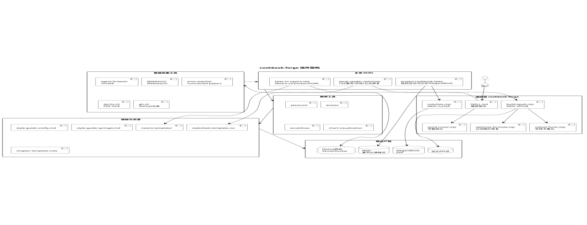
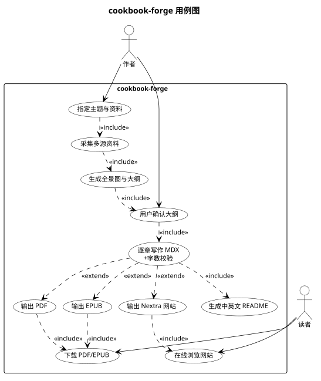
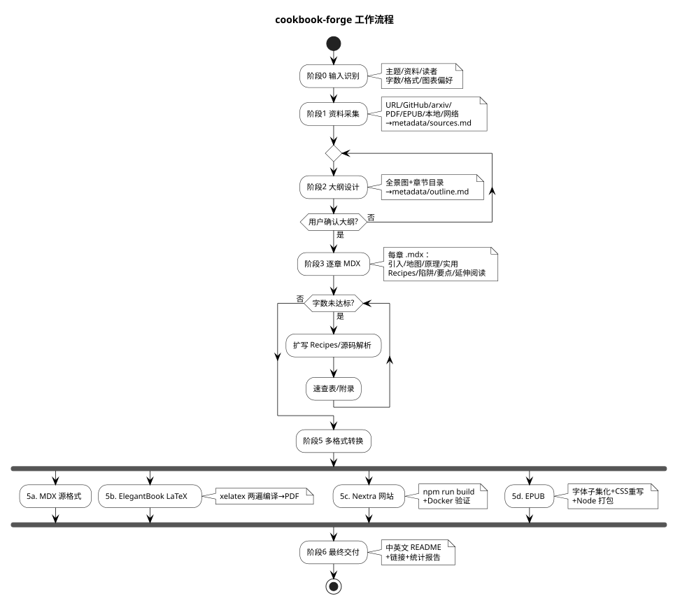

<p align="center">
  
</p>

<h1 align="center">Cookbook Forge</h1>

<p align="center">
  <strong>cookbook-forge</strong> — 领域 CookBook / Handbook / Survey 生成器
</p>

<p align="center">
  从多源资料出发，按 O'Reilly CookBook 与 Springer Handbook 风格，<br>
  先生成章节化 MDX，再转换为 ElegantBook PDF、Nextra 网站、优化 EPUB、Typst PDF。
</p>

<p align="center">
  <a href="https://www.skills.sh/samonysh/cookbook-forge"></a>
  <a href="https://github.com/samonysh/cookbook-forge/releases/tag/v1.11.0"></a>
  <a href="https://github.com/samonysh/cookbook-forge/blob/main/LICENSE"></a>
</p>

<p align="center">
  <code>npx skills add samonysh/cookbook-forge</code>
</p>

---

## 这是什么

`cookbook-forge` 是一个编排型 Skill，用于根据用户提供的自然语言需求与多种资料源（网页、PDF、EPUB、GitHub 仓库、arxiv 论文、项目文档等），生成一本结构完整、内容深入的技术书籍。

它组合并吸收了三个既有 Skill 的核心能力：

- **project-cookbook-latex**：资料穷尽、源码级分析、按覆盖度定篇幅的深度长文结构、ElegantBook 排版规范、PDF 质量闸门
- **latex-to-nextra-site**：Nextra v3 站点工程、Docker 部署、章节重编号、PlantUML/Drawio 渲染、MDX 转换
- **epub-reader-optimizer**：EPUB CSS 重写、字体子集化嵌入、公式图片修复、合规打包

## 能做什么

- 📚 **生成任意技术领域的 CookBook / 手册 / 综述**
- 🔍 **多源资料采集**：网页爬取（含 sitemap）、GitHub 仓库、arxiv 论文、PDF OCR、EPUB 解包、本地源码/文档、网络搜索
- 🔍 **论文搜索**：支持 `paper-search`（MCP）从 arXiv、PubMed、Semantic Scholar 等 20+ 来源搜索论文
- 🏛️ **架构先行**：先生成整体全景图与章节大纲，与用户对齐后再逐章写作
- 📝 **MDX 为权威中间格式**：每章一个 `.mdx`，便于后续多格式转换
- ⚙️ **双转换路径**：LLM 逐章转换（三个 Prompt）与 `mdx2book.mjs` 确定性转换并存；后者按块解析、正文逐字保留，图表使用显式编号 `fig-NN-M`，适合结构固定的章节
- 🧾 **写作过程可审计**：四类 HTML 注解（`track` / `verify` / `source` / `FIGURE`）在 MDX 内保留、转换时统一剥离；`chapter-lint.mjs` 校验 N.0–N.10 骨架、图位、验证等级与逐块实测记录
- 📊 **双线比例实测**：`ratio-count.mjs` 按 `track` 统计正文 CJK（剔除代码块、HTML 注释与 meta；表格内 CJK 按 1/2 计数），`--write` 回填 frontmatter 并输出报告；对「有表但成段论述 <120 字」或「表格折算占比 >60% 且成段论述 <300 字」的小节报 WARN；综合段按 10%–15% 判定，含章末回收段的章节上限放宽到 18%（下限 10% 不变）
- 📐 **篇幅按覆盖度定**：A0/A1 后按模块数 × 递归深度 × 概念密度定全书总量；下限 5 万 CJK（`body3` 口径：不含 meta，表格按 1/2 计数），不设逐章固定预算，章长按模块权重分配
- 🖼 **封面闸门**：无素材时用 diagram-design 画全书架构图（spine / 模块分群 / 依赖方向）；`latex-check.mjs` 校验封面存在、1280×1024、非空白
- 🎨 **丰富图表**：HTML 图源（`assets/diagram-style/` 导出 SVG）/ mermaid / plantuml / drawio / excalidraw / chart，按用户偏好选用
- 📖 **MDX + 四种最终格式**（可组合）：
  - **MDX**（默认）：章节化 Markdown + JSX，适合作为源格式
  - **ElegantBook LaTeX + PDF**：基于 [ElegantLaTeX/ElegantBook](https://github.com/ElegantLaTeX/ElegantBook)，xelatex 编译
  - **Nextra v3 网站**：基于 [Nextra](https://nextra.site)，支持明暗模式、全文搜索、i18n、KaTeX、一键 Vercel/Docker 部署
  - **优化 EPUB**：LXGW WenKai 子集化嵌入、booktabs 表格、tcolorbox 风格代码块、兼容老旧阅读器
  - **Typst PDF**：基于 [ilm](https://typst.app/universe/package/ilm) 模板，LXGW WenKai 中文字体、四色 callout 提示框、booktabs 表格、代码块圆角边框
- 🌏 **中英文 README 自动生成**（书籍项目自带）

## 何时使用

当用户提出以下任一需求时调用：

- "帮我写一本关于 X 的 CookBook / 手册 / 综述 / 技术书"
- 提供多种资料（网页、PDF、GitHub 仓库）要求整理为**多章长文**
- 要求输出 PDF、在线网站、EPUB 中的任一或多个
- 明确提到参考 O'Reilly CookBook 或 Springer Handbook 风格

## 目录结构

```
cookbook-forge/
├── SKILL.md                              # Skill 主文件（编排指令）
├── README.md                             # 中文说明（本文件）
├── README.en.md                          # 英文说明
├── scripts/
│   ├── lib/
│   │   ├── diagram-renderer.mjs          # 统一图表渲染 pipeline（mermaid/plantuml -> Kroki SVG）
│   │   ├── mdx-utils.mjs                 # MDX frontmatter 解析与 HTML 注释剥离
│   │   ├── latex-lint.mjs                # LaTeX lint/fix 规则库
│   │   ├── epub-lint.mjs                 # EPUB XHTML lint/fix + XML 良构校验规则库
│   │   ├── typst-lint.mjs                # Typst lint/fix 规则库
│   │   ├── typst-optimize.mjs            # Typst 确定性优化（label 注入、引用改写等）
│   │   ├── word-caliber.mjs              # 正文口径（CJK / 表格 ×0.5 / meta 剔除），word-count 与 ratio-count 共用
│   │   └── cli-args.mjs                  # CLI 参数约定（--root 只认等号写法）
│   ├── lmdx2tex.mjs                      # LLM 驱动 MDX -> ElegantBook LaTeX 转换
│   ├── latex-check.mjs                   # LaTeX 静态 lint + 规则修复 + 每章并行 probe 编译
│   ├── lmdx2typst.mjs                    # LLM 驱动 MDX -> Typst（ilm 模板）转换
│   ├── typst-check.mjs                   # Typst 静态 lint + 规则修复 + 每章并行 probe 编译
│   ├── typst-fonts-check.mjs             # Typst 字体可用性预检
│   ├── lbuild-epub.mjs                   # LLM 驱动 MDX -> EPUB3 转换（按书名输出）
│   ├── build-book.mjs                    # 统一构建：EPUB / LaTeX PDF / Typst PDF 按书名命名
│   ├── epub-check.mjs                    # EPUB 静态 lint + 每章 XML 良构校验 + 包结构检查
│   ├── mdx2book.mjs                      # 确定性 MDX -> Typst/LaTeX/EPUB 章节转换（显式图号）
│   ├── chapter-lint.mjs                  # 章节结构 lint（N.0–N.10、标记、图位、实测记录）
│   ├── ratio-count.mjs                   # 双线比例 + 正文口径统计（表格 1/2，only-table WARN）
│   ├── render-figures.mjs                # 图源 -> SVG 导出与图位校验
│   ├── render-diagrams.mjs               # 图表渲染（mermaid/plantuml -> SVG）
│   ├── word-count.mjs                    # 字数统计（与 ratio-count 共用正文口径）
│   ├── epub-zip.mjs                      # EPUB 合规打包
│   ├── subset-fonts.mjs                  # 字体子集化
│   ├── optimize-formula-images.mjs       # 公式图片修复
│   ├── kroki-render.mjs                  # PlantUML Kroki 渲染
│   └── build-skill.mjs                   # Skill 打包脚本
├── references/
│   ├── style-guide-oreilly.md            # O'Reilly CookBook 写作风格参考
│   ├── style-guide-springer.md           # Springer Handbook 写作风格参考
│   ├── technical-book-analysis-methodology.md # 前置分析方法论（定·拆·图·深·织）
│   ├── readability-style-guide.md        # 可读性写作规范（W1–W7）
│   ├── narrative-structure-guide.md      # 组织层写作规范（O1–O9 / G1–G6）
│   ├── stage-5a-mdx.md                   # 阶段 5a：MDX 输出子流程
│   ├── stage-5b-latex.md                 # 阶段 5b：LaTeX + PDF 子流程
│   ├── stage-5c-nextra.md                # 阶段 5c：Nextra 网站子流程
│   ├── stage-5d-epub.md                  # 阶段 5d：EPUB 子流程
│   └── stage-5e-typst.md                 # 阶段 5e：Typst 子流程
└── assets/
    ├── prompts/
    │   ├── mdx-to-latex.md               # MDX->LaTeX 转换 Prompt
    │   ├── mdx-to-epub.md                # MDX->EPUB XHTML 转换 Prompt
    │   └── mdx-to-typst.md               # MDX->Typst 转换 Prompt
    ├── template-mdx/
    │   └── chapter-template.mdx          # 单章 MDX 写作模板
    ├── diagram-style/                    # vendored diagram-design 出图样式（HTML -> SVG）
    ├── nextra-template/                  # Nextra 站点骨架
    ├── elegantbook-main.template.tex.txt # ElegantBook LaTeX 模板
    ├── ilm-template.typ.txt              # Typst ilm 模板（优化样式）
    ├── ilm-callout.typ.txt               # callout-box 四色提示框独立模块
    ├── stylesheet.template.css           # EPUB 基础 CSS
    └── stylesheet.formula-image.css      # 公式图片型 EPUB CSS
```

## 组件架构



## 用例图



## 工作流程概览



<details>
<summary>文字版流程</summary>

```
阶段 0  输入识别     → 主题/资料/读者/字数/格式/图表偏好
阶段 1  资料采集     → URL/GitHub/arxiv/PDF/EPUB/本地/网络补充 → metadata/sources.md
阶段 2  大纲设计     → 全景图 + 章节目录 → metadata/outline.md ⚠️ 必须用户确认
阶段 3  逐章 MDX     → 每章 .mdx：引入/地图/原理/实用/Recipes/陷阱/要点/延伸阅读
阶段 4  篇幅校准     → 按覆盖度扩写 Recipes/源码解析/速查表/附录；下限 5 万 CJK（body3 口径，表格按 1/2），不设逐章预算
阶段 5  多格式转换（每种格式生成后子 agent 检查修复）
  5a.  MDX          （默认）
  5b.  ElegantBook  -> xelatex 两遍编译 -> <书名>.pdf
  5c.  Nextra 网站  -> npm run build + Docker 验证
  5d.  EPUB         -> 标题层级 CSS + 字体子集化 + epub-zip.mjs 打包 -> <书名>.epub
  5e.  Typst        -> ilm 模板 + typst compile -> <书名>.pdf
阶段 6  最终交付     → 中英文 README + 链接 + 统计报告
```

</details>

## 依赖的 Skills / 工具

执行时按需联动：

- `agent-browser` / `vivaldi-automation`：网页爬取与站点地图遍历
- `WebFetch` / `WebSearch`：网络资料抓取
- `arxiv-watcher` / `connected-papers-browser`：论文检索
- `paper-search`（MCP）：论文搜索（arXiv、PubMed、Semantic Scholar 等 20+ 来源）
- `doc2x-cli`：PDF OCR / 解析
- `gh-cli`：GitHub 仓库读取
- `plantuml` / `drawio` / `excalidraw` / `chart-visualization`：图表生成
- `elegantbook-latex`：LaTeX 排版优化
- Typst CLI（用于 Typst PDF 编译，仅在需要 Typst 输出时）
- Node.js ≥ 18.17（Nextra 构建 / EPUB 打包 / 字体子集化）
- 可选：`fonteditor-core`（`npm install fonteditor-core`，用于字体子集化；若未安装，脚本会提示并给出 Python fonttools fallback）
- Docker（用于 PlantUML 渲染和 Nextra 部署验证）
- XeLaTeX（用于 ElegantBook PDF 编译，仅在需要 PDF 输出时）
- Python 3（仅作为字体子集化 fallback，非必需）

## 质量闸门

交付前必须通过：

- [ ] 大纲已与用户对齐
- [ ] 每章一个 MDX，frontmatter 完整，含引入/地图/要点/延伸阅读
- [ ] 代码块全部带语言标识 + 中文注释
- [ ] 图表有编号、标题、正文引用、说明段落
- [ ] 章节骨架：`chapter-lint.mjs --strict` 退出码 0（N.0–N.10、四类注解、图位与 frontmatter 一致、逐块实测记录）
- [ ] 双线比例：`ratio-count.mjs --write` 报告存在，`ratio` 已回填 frontmatter；「只有表格 / 成段论述不足」WARN 已处理
- [ ] 四类 HTML 注解（track / verify / source / FIGURE）未泄漏到 `.tex` / `.typ` / XHTML
- [ ] 跨章引用为可点击链接
- [ ] 全书 `body3` ≥5 万 CJK（只算正文：剔除代码块、HTML 注释、meta；表格按 1/2 计数）；总量与模块权重一致，超出同类参考区间已写明理由
- [ ] 三端产物不入库：书籍仓库不含 `*.pdf`、`*.epub` 与 `latex/`、`typst/`、`epub/`、`mdx/` 构建目录；发布走 tag + Release 附件
- [ ] 封面通过 `latex-check.mjs` 闸门（存在、1280×1024、非空白）
- [ ] PDF：`latex-check.mjs --fix --compile` 退出码 0；`build-book.mjs --format=latex` 产出 `<书名>.pdf`；无 Markdown 残留
- [ ] Nextra：`npm run build` 通过；Docker healthy；`/zh` 200
- [ ] EPUB：`epub-check.mjs --fix` 退出码 0（每章 XML 良构 + 包结构）；产物为 `<书名>.epub`；mimetype 第一且 STORED；字体子集化嵌入；标题层级与代码块/表格样式生效
- [ ] Typst：`typst-check.mjs --fix --compile` 退出码 0；`build-book.mjs --format=typst` 产出 `<书名>.pdf`；无 Markdown/LaTeX 语法残留；数学块内无裸中文/裸缩写；中文字体正确配置
- [ ] Typst：`main.typ` 包含 `@preview/ilm:<version>` 与 `#show: ilm.with(...)`；缺失时 `--fix` 可自动重新补充
- [ ] 图表：原始源码保留在 diagrams-src/，渲染产物在 figures/

### 书籍产物不入库

本 Skill 仓库只收录 Skill 本体（`scripts/`、`assets/`、`references/` 与文档）。PDF、EPUB 与 Typst/LaTeX/EPUB 构建目录（`latex/`、`typst/`、`epub/`、`mdx/`）一律不入库；书籍工程需在自己的 `.gitignore` 中排除这些目录与 `*.pdf`、`*.epub`。需要发布时用 git tag + GitHub Release 附件分发二进制产物，不把二进制提交进仓库。提交前自查：`git log -p --all` 查项目名/模块包名/用户名应为 0 命中，`git ls-files` 不应含上述产物；命中时先在仓库外 `git bundle` 备份，再重写历史并 `--force-with-lease` 推送。

## 安装与发布

### 通过 skills.sh 安装

```bash
npx skills add samonysh/cookbook-forge
```

### 通过 SkillHub 发布

本 Skill 目录结构符合 [SkillHub 发布规范](https://skillhub.cn/tutorials#publish-manage-skill)：

- ✅ 根目录 `SKILL.md`（含 `name` / `slug` / `displayName` / `version` / `license` / `summary` / `description` / `tags` 等 frontmatter）
- ✅ `scripts/` 可执行脚本（`.mjs`）
- ✅ `references/` 按需加载的参考文档（写作风格指南 + 阶段 5 子流程）
- ✅ `assets/` 模板与资源文件（Prompts、MDX 模板、Nextra 骨架、CSS、Typst 模板）
- ✅ 中英文 `README.md` / `README.en.md`

打包发布：

```bash
node scripts/build-skill.mjs          # 生成 dist/cookbook-forge-1.11.0.zip
skillhub publish ./cookbook-forge --changelog "v1.11.0: EPUB 标题层级重做（h1–h4 1.9/1.5/1.22/1.08em，层级化留白与字重，相对单位），配色改为 inherit + 中性半透明灰，深浅色与阅读器反色均可读；EPUB/LaTeX PDF/Typst PDF 统一按书名命名（metadata/outline.md 解析 + 跨平台非法字符清洗），新增 build-book.mjs 统一构建入口"
```

## License

MIT
